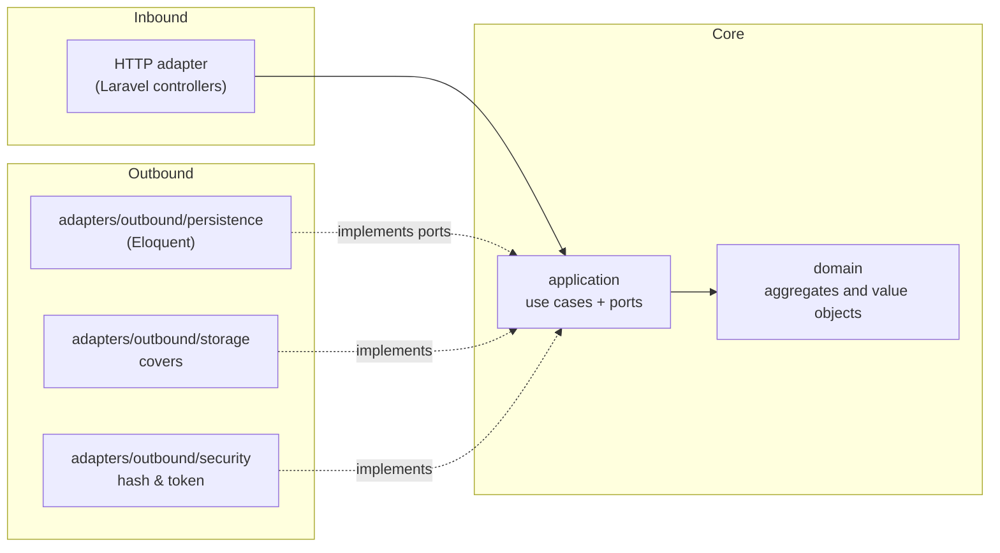

# Architecture — Manager Library (PHP/Laravel)

**Hexagonal** architecture (ports and adapters). The dependency rules are articles I‑III of [`constitution.md`](constitution.md).

## 1. Layers and dependencies



Dependency arrows point **inward**. `bootstrap` is the only one that sees both halves.

## 2. Folder structure

```text
app/
├── Domain/               # Book, Loan, LoanItem, Member, User; Isbn, Quantity, DateRange
├── Application/
│   ├── Ports/Outbound/  # BookRepository, LoanRepository, MemberRepository, UserRepository,
│   │                    # ReportReader, Clock, PasswordHasher, TokenIssuer, CoverStorage
│   └── Services/        # LendBooksService, ReturnItemService, CreateBookService, SearchBooksService,
│                        # OverdueService, MostBorrowedReportService, LoginService, CreateLibrarianService
├── Infrastructure/
│   ├── Http/            # Controllers, request validation, error handling
│   └── Outbound/        # Persistence/, Storage/, Security/
├── Providers/           # ServiceProvider bindings (only composition root)
└── Console/             # Commands
└── Http/                # Laravel's default controllers (legacy or thin wrappers)
```

## 3. Aggregates

| Root | Contains | Invariants it defends |
|---|---|---|
| `Book` | `Isbn`, total and available copies, soft delete | available between 0 and total; total ≥ 1; non‑empty title |
| `Loan` | collection of `LoanItem` | 1 to 3 items; no repeated book; due date 14 days; immutable except return |

## 4. Domain model principles

- **Domain layer** imports **nothing** from Application, Infrastructure, or external packages (article I).
- **Application layer** defines ports that Infrastructure implements (article II).
- **Only `Providers/`** instantiate Infrastructure classes (article III).
- **Value objects** (`Isbn`, `Quantity`, `DateRange`) are immutable and validate themselves.
- **Repositories** return aggregates; they hide persistence details.

## 5. Database interaction

- **Migrations** own the entire schema (ADR-001).
- **Eloquent models** live only in Infrastructure/Persistence/, not in Domain.
- **Transactions** are managed at the use‑case level, not in adapters.
- **Concurrency** is handled optimistically (ADR-002) with a version column.

## 6. Testing strategy

| Layer | What to test | How |
|---|---|---|
| Domain | Invariants, value‑object validation | Unit tests, no dependencies |
| Application | Use‑case logic | Unit tests with fake ports |
| Infrastructure | Adapters work correctly | Integration tests (real database, filesystem, JWT) |
| HTTP | Routes and error responses | Contract tests (Postman/HTTP) |
| Composition | Provider bindings | Architecture tests (no forbidden imports) |

## 7. Deployment

- **One command** (`docker compose up`) brings up empty PostgreSQL, Laravel, and frontend.
- **Initial admin** is created from environment variables at startup.
- **Demonstration seeder** (`tool`) uses the API, never raw SQL.
- **Covers** are stored outside the database (local disk or S3).